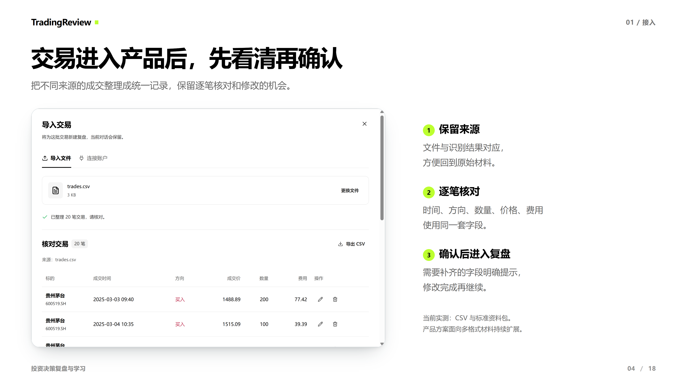
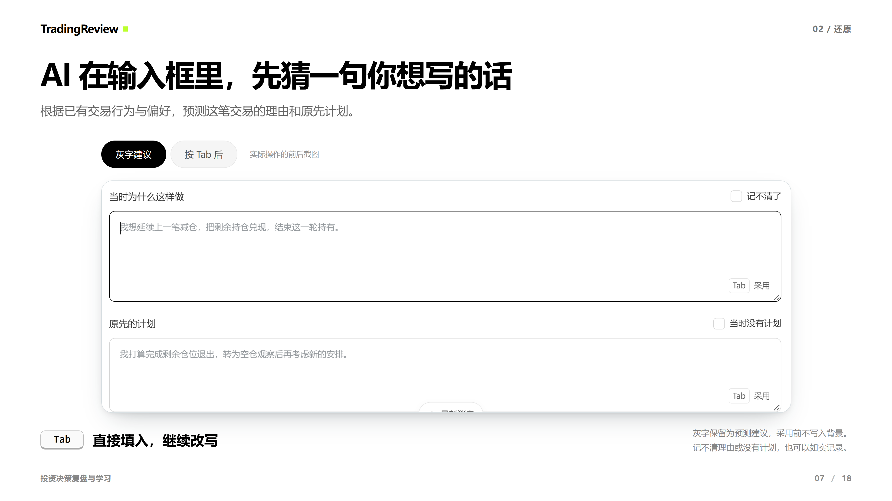
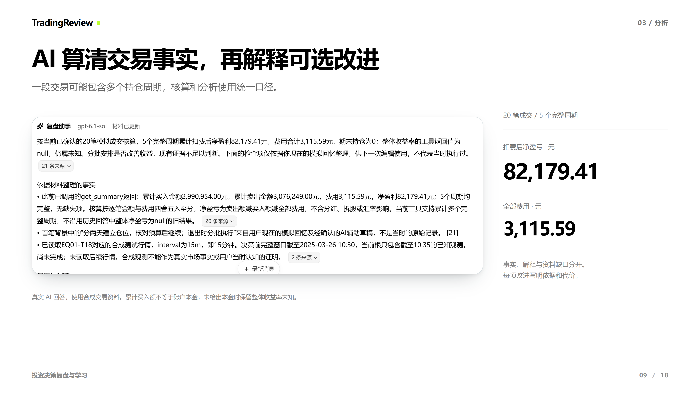
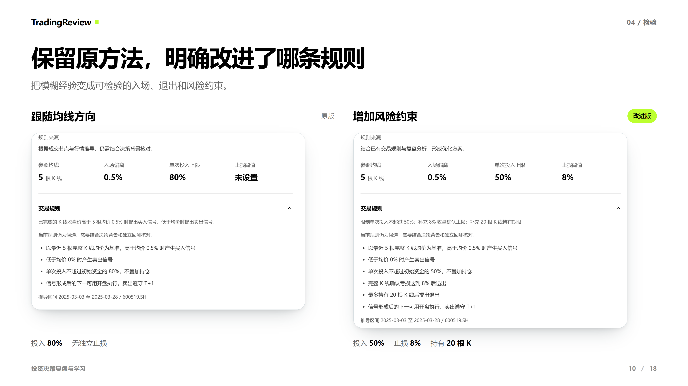
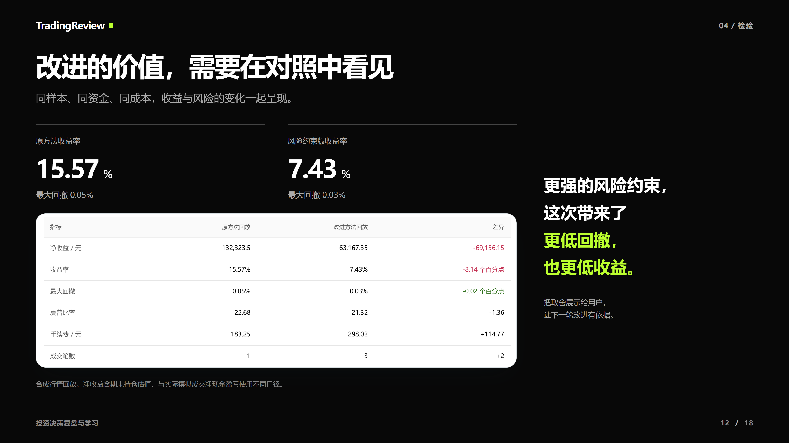
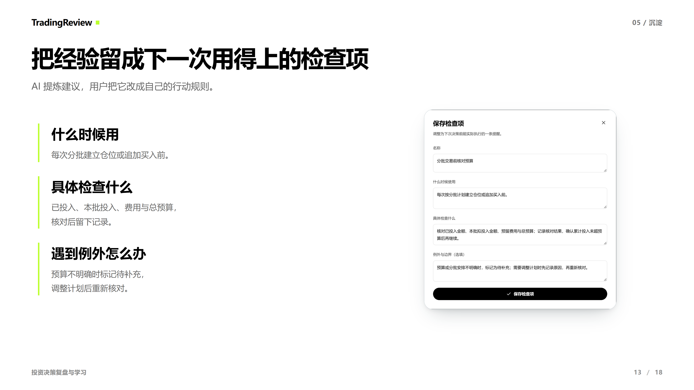

<div align="center">
  <picture>
    <source media="(prefers-color-scheme: dark)" srcset="docs/images/brand/tradingreview-logo-dark.png">
    
  </picture>
  <h3>Learn from every trade. Improve your next decision.</h3>
  <p>Reconstruct the context, examine the evidence, and turn each review into testable trading methods and practical checklists.</p>
  <p>
    <a href="https://tradingreview.cht.me/quick"><b>Quick Demo</b></a> ·
    <a href="https://tradingreview.cht.me/">Full App</a> ·
    <a href="https://okht.github.io/tradingreview/">Product Tour</a> ·
    <a href="https://okht.github.io/tradingreview/presentation.html">Slide Deck</a> ·
    <a href="https://okht.github.io/tradingreview/presentation.pptx">Download PowerPoint</a>
  </p>
</div>

## Overview

TradingReview is an AI-assisted workspace for reviewing investment decisions and learning from past trades. It brings transaction records, decision context, supporting evidence, and follow-up actions into one workflow:

**Import trades → Reconstruct context → Review with AI → Refine and backtest methods → Save checklists**

Start with a single trade or a group of trades, investigate what happened, and turn the findings into rules you can test and checks you can use next time. The quick demo includes a prepared case to explore immediately. The full app lets you connect your own model and work through the process with your own records.

## Product Preview

These six slides from the [product presentation](https://okht.github.io/tradingreview/presentation.html) show the core workflow using screenshots of the application. Click an image to open the corresponding slide. The product interface and presentation shown in the screenshots are in Chinese.

<table>
  <tr>
    <td align="center" width="50%" valign="top">
      <a href="https://okht.github.io/tradingreview/presentation.html#4"></a>
      <br><b>Import and Verify Trades</b>
      <br><sub>Normalize transaction fields and check or edit each record before confirming.</sub>
    </td>
    <td align="center" width="50%" valign="top">
      <a href="https://okht.github.io/tradingreview/presentation.html#7"></a>
      <br><b>Reconstruct Decision Context</b>
      <br><sub>Review suggested reasons and plans, accept them with Tab, and refine them in your own words.</sub>
    </td>
  </tr>
  <tr>
    <td align="center" width="50%" valign="top">
      <a href="https://okht.github.io/tradingreview/presentation.html#9"></a>
      <br><b>Review with Evidence</b>
      <br><sub>Inspect calculated trade facts, AI interpretations, and suggestions alongside their sources.</sub>
    </td>
    <td align="center" width="50%" valign="top">
      <a href="https://okht.github.io/tradingreview/presentation.html#10"></a>
      <br><b>Refine Trading Methods</b>
      <br><sub>Keep the original method, make each proposed change explicit, and save a new version.</sub>
    </td>
  </tr>
  <tr>
    <td align="center" width="50%" valign="top">
      <a href="https://okht.github.io/tradingreview/presentation.html#12"></a>
      <br><b>Compare Backtests</b>
      <br><sub>Compare returns, drawdowns, and execution using the same data, capital, and cost settings.</sub>
    </td>
    <td align="center" width="50%" valign="top">
      <a href="https://okht.github.io/tradingreview/presentation.html#13"></a>
      <br><b>Build Pre-Trade Checklists</b>
      <br><sub>Capture lessons as trigger conditions, concrete actions, and exceptions for future decisions.</sub>
    </td>
  </tr>
</table>

Demo cases use real stock identifiers with simulated trades, market prices, and user behavior. See [Data and Validation](#data-and-validation) for the scope of the sample data and recorded checks.

## Try It

| Entry | What you can do |
|---|---|
| [Quick Demo](https://tradingreview.cht.me/quick) | Explore a prepared case, read the saved AI review, inspect citations, edit checklists, and rerun backtests. |
| [Full App](https://tradingreview.cht.me/) | Connect your own model, import trades, and complete the review workflow from the beginning. |
| [Product Tour](https://okht.github.io/tradingreview/) | Browse a visual walkthrough of the product. |

For a three-to-five-minute introduction, open the quick demo and:

1. Read the saved review and follow its citations.
2. Expand the trade and material panel to inspect the 15-minute candlesticks, decision context, and evidence.
3. Open the trading methods section and rerun a backtest.
4. Edit and save a checklist, then refresh to check that your changes persist.

The prepared review can be read immediately. Generating new AI responses requires your own model connection. The hosted app connects through model APIs; the local version also supports ChatGPT subscription OAuth. The full app and quick demo save separate workspaces, and each visitor receives an isolated workspace.

## Run Locally

Requires **Node.js 22.19 or later** and npm.

```sh
git clone https://github.com/okht/tradingreview.git
cd tradingreview/prototype
npm ci
npm run dev
```

The development command starts the frontend and local API together. The default frontend address is `http://127.0.0.1:5173`; check the terminal output if that port is in use. Connect your model in the app settings to generate new AI responses.

See the [application documentation](prototype/README.md) for environment variables, model connections, data sources, build commands, and implementation details.

## Repository Guide

| Path | Contents |
|---|---|
| [prototype/](prototype/) | Application source, locked dependencies, automated tests, and simulated datasets. |
| [prototype/README.md](prototype/README.md) | Setup instructions, configuration, supported workflows, and known limitations. |
| [prototype/evaluation/](prototype/evaluation/) | Evaluation fixtures, reference calculations, and reproducible validation instructions. |
| [prototype/verification/](prototype/verification/) | Dated validation records and supporting evidence. |
| [Presentation source](%E6%BC%94%E7%A4%BA/Slidev%E6%BA%90%E7%A0%81/) | Editable Slidev slides and original screenshots. |
| [docs/images/](docs/images/) | Brand assets and the six full-resolution preview slides used above. |

## Data and Validation

The quick demo contains **20 simulated trades** for Kweichow Moutai (`600519.SH`), synthetic 15-minute market data, and saved AI responses from a recorded validation run. The stock identity is real; transactions, prices, market observations, behavior, and decision context are constructed examples. Return figures illustrate the application workflow.

The repository includes **50 simulated datasets** covering 10 real A-share stocks across five scenarios. Each dataset contains 20–40 trades, for a total of **1,500 trades and 16,000 fifteen-minute candlesticks**. Recorded offline checks cover the data and calculation contracts for all 50 datasets. A complete evaluation of live model quality across those datasets remains outstanding.

The prepared case has recorded validation of the AI review, method refinement, backtest, and checklist workflow. Automatic background preparation has a known limitation: later batches can reach the execution limit. Dated validation records describe what was checked at each stage; they should be read alongside the current application documentation.

## Presentations

- [Scrolling product tour](https://okht.github.io/tradingreview/)
- [18-slide presentation](https://okht.github.io/tradingreview/presentation.html)
- [Download the PowerPoint deck](https://okht.github.io/tradingreview/presentation.pptx)

The presentation assets preserve the original screenshot resolution, proportions, rounded corners, and shadows. PowerPoint slides use exported images; use the Slidev source to edit the layouts.
