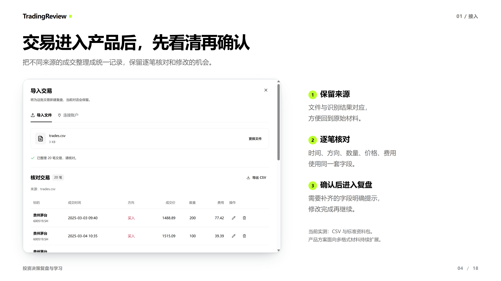
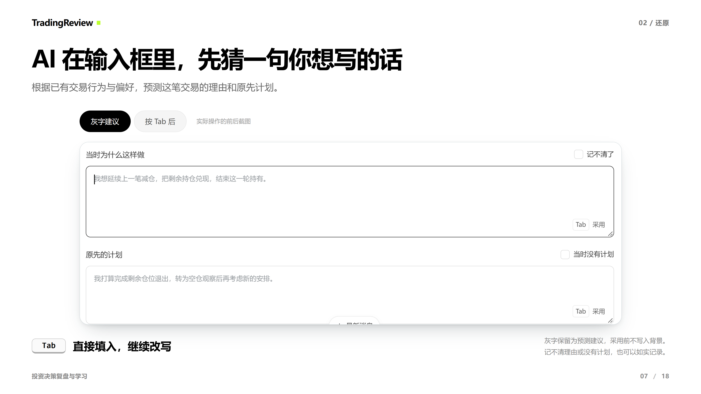
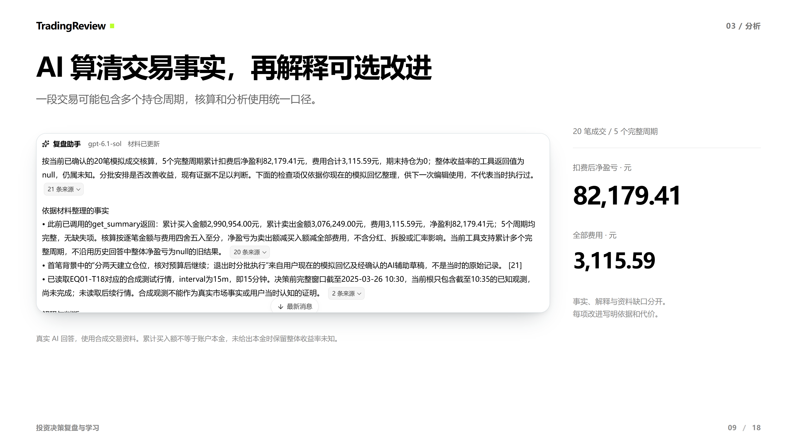
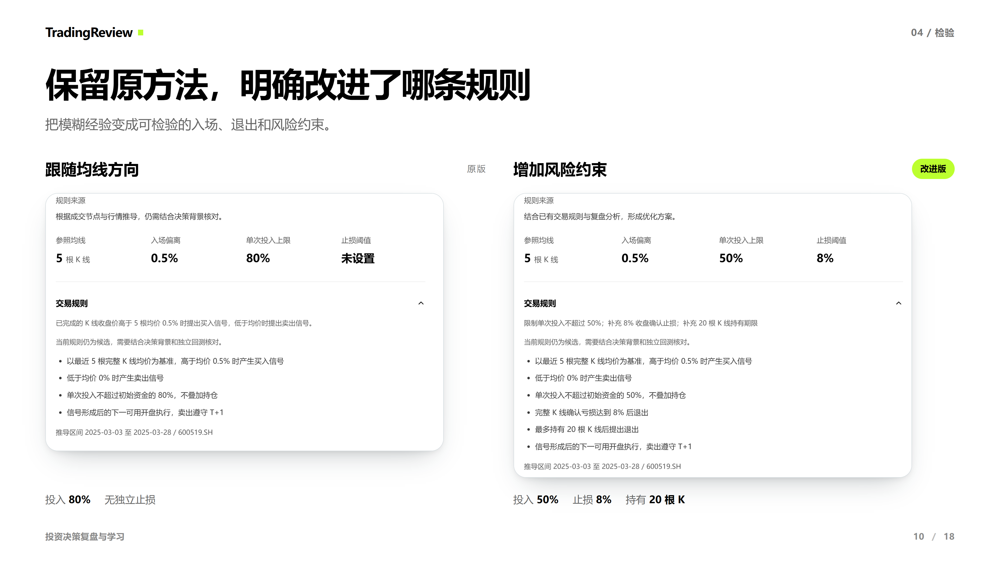
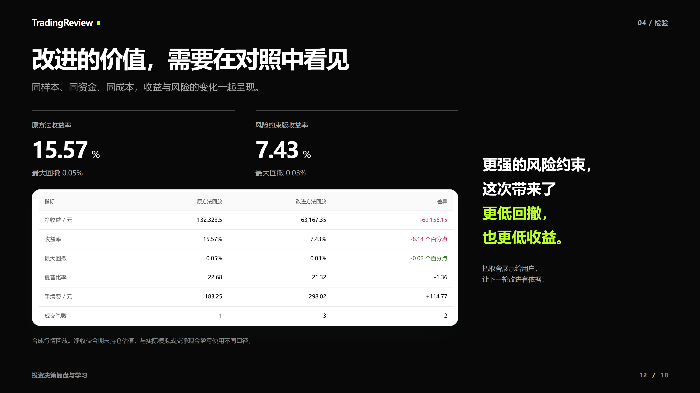
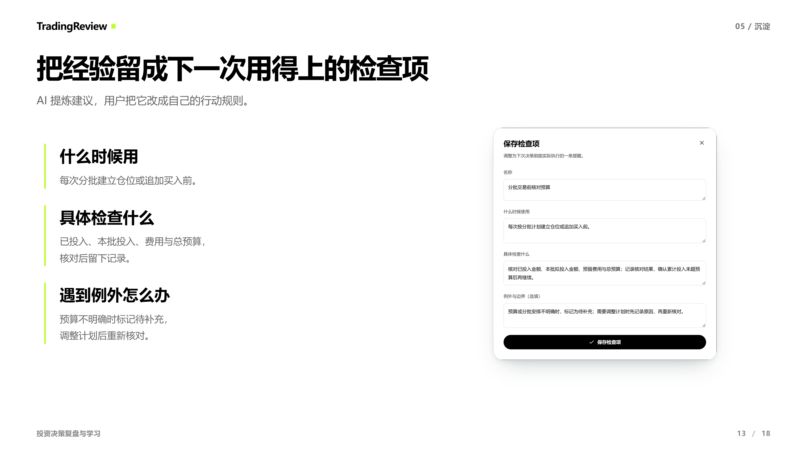

  <picture>
    <source media="(prefers-color-scheme: dark)" srcset="docs/images/brand/tradingreview-logo-dark.png">
    
  </picture>
  <h3>从每笔交易，走向下一次改进。</h3>
  
还原决策背景，核对相关证据，把复盘沉淀为可检验的方法和可执行的检查项。

  

    <a href="https://tradingreview.cht.me/quick"><b>快速体验</b></a> ·
    <a href="https://tradingreview.cht.me/">完整版</a> ·
    <a href="https://okht.github.io/tradingreview/">产品介绍</a> ·
    <a href="https://okht.github.io/tradingreview/presentation.html">幻灯片演示</a> ·
    <a href="https://okht.github.io/tradingreview/presentation.pptx">下载演示文稿</a>
  

## 简介

TradingReview 是一个投资决策复盘与学习产品。围绕一次或一组历史交易，串联「导入交易 → 背景与证据 → AI 复盘 → 改进交易方法与回测 → 沉淀检查项」，帮助用户看清这次发生了什么，也留下下次可以怎样做。

快速体验版已准备好经典案例，可以直接查看复盘、检查证据、编辑方法与检查项，并重新运行回测。完整版支持连接自己的模型，从导入材料开始完成整个流程。

## 产品预览

以下为[在线演示](https://okht.github.io/tradingreview/presentation.html)中的 6 张关键幻灯片，使用实际产品页面截图。点击图片可进入对应页面；图像保留原始 4K 分辨率、截图比例、圆角和阴影。

<table>
  <tr>
    <td align="center" width="50%" valign="top">
      
       <b>导入交易</b>
       统一成交字段，保留逐笔核对与修改的机会。
    </td>
    <td align="center" width="50%" valign="top">
      
       <b>决策背景建议</b>
       根据已有行为预测理由与计划，按 Tab 填入后继续改写。
    </td>
  </tr>
  <tr>
    <td align="center" width="50%" valign="top">
      
       <b>AI 复盘与证据</b>
       算清交易事实，区分解释与建议，保留来源供核对。
    </td>
    <td align="center" width="50%" valign="top">
      
       <b>改进交易方法</b>
       保留原方法，明确每一条改进，再保存为新版本。
    </td>
  </tr>
  <tr>
    <td align="center" width="50%" valign="top">
      
       <b>同条件回测对照</b>
       用相同数据与成本设置，观察收益、回撤和执行差异。
    </td>
    <td align="center" width="50%" valign="top">
      
       <b>沉淀交易前检查项</b>
       把经验写成触发条件、检查动作与例外，供下一次使用。
    </td>
  </tr>
</table>

演示案例采用真实股票身份，交易、行情与用户行为为模拟数据；具体实现范围与验证记录见下文。

## 直接体验

| 入口 | 地址 | 适合怎样体验 |
|---|---|---|
| 快速体验版 | https://tradingreview.cht.me/quick | 打开已有经典案例，查看 AI 复盘、核对引用、编辑检查项并重新回测 |
| 完整版 | https://tradingreview.cht.me/ | 连接自己的模型，导入交易，从头完成复盘流程 |
| 源代码仓库 | https://github.com/okht/tradingreview | 查看产品源码、README、测试与演示材料 |
| 在线产品介绍 | https://okht.github.io/tradingreview/ | 浏览演示内容；实际操作使用上面的两个产品入口 |

建议先用快速版体验 3–5 分钟：阅读复盘 → 展开「查看交易与材料」 → 核对 15 分钟 K 线、决策背景与引用 → 在「交易方法」重新运行回测 → 在「检查项」编辑并保存，再刷新确认。快速版的已有复盘可以直接阅读；继续产生新的 AI 回答时，需要连接自己的模型。

公开云端通过模型 API 连接，密钥由体验者自行填写；本地版本另外支持 ChatGPT 订阅 OAuth。提交包不包含个人模型授权或金融接口密钥。完整版与快速版的工作区独立保存，不同访客的工作区相互隔离。

## 文件索引

本仓库对应笔试平台的**第 2 题「投资决策复盘与学习」**。题目附件的文件编号为 `11`。

| 文件或目录 | 用途 |
|---|---|
| [提交文档/01_题目要求核对.md](提交文档/01_题目要求核对.md) | 逐项对应题目要求，说明当前实现与边界 |
| [提交文档/02_AI使用与验证记录.md](提交文档/02_AI使用与验证记录.md) | AI 的参与范围、候选人提出的修正、工具发现的缺陷与复测证据 |
| [提交文档/03_测试说明.md](提交文档/03_测试说明.md) | 主链路、数据缺失/接口失败、极端与合规场景，保留失败记录 |
| [prototype/README.md](prototype/README.md) | 本地启动、环境变量、产品选择、数据和 AI 角色、已知边界 |
| [prototype/](prototype/) | 可运行源码、锁定依赖、第三方许可、自动测试与模拟数据 |
| [演示/投资决策复盘与学习.pptx](演示/投资决策复盘与学习.pptx) | 高清 PowerPoint；18 页，保留截图比例、圆角和阴影 |
| [演示/投资决策复盘与学习.html](演示/投资决策复盘与学习.html) | 双击即可打开的单文件演示网页；图片已内嵌 |
| [演示/Slidev源码/](演示/Slidev源码/) | 可继续编辑的演示源文件与原始高清截图 |
| [docs/images/](docs/images/) | 仓库首页使用的标志与 6 张原始高清幻灯片 |
| [文件清单.tsv](文件清单.tsv) | 归档文件、字节数与 SHA-256 校验值 |

PPT 和 HTML 用于辅助说明产品，不替代上述可实际操作的 Web 入口。PPT 页面采用高清图像导出；版式继续编辑请使用 Slidev 源码。可选的 60–180 秒演示视频本次未提供。

## 数据与验证口径

快速版使用贵州茅台 `600519.SH` 的 20 笔模拟成交、15 分钟合成行情，以及实际验收调用生成的历史 AI 回复。股票身份真实；成交、价格、行情、行为和背景均为构造数据，收益数字只用于核对产品流程。

源码内包含 50 组模拟数据：10 个真实 A 股标的 × 5 类情境，每组 20–40 笔，共 1,500 笔成交、16,000 根 15 分钟 K 线。已完成 50 组离线数据与计算契约验证；尚未完成 50 组真实模型质量评测。经典案例已完成真实 AI 复盘、方法改进、回测与检查项链路；整组自动背景准备仍有后续批次失败的已知限制，详细记录见测试说明。

文档中的早期审计和分阶段记录保留各自日期及当时结论。当前交付状态优先参考本目录、最新产品 README 和测试说明的「公开部署追加验证」章节。

## 在线产品介绍

- [连续滚动介绍网页](https://okht.github.io/tradingreview/)
- [18 页演示版](https://okht.github.io/tradingreview/presentation.html)
- [下载高清 PowerPoint](https://okht.github.io/tradingreview/presentation.pptx)
- [打开快速体验产品](https://tradingreview.cht.me/quick)

介绍网页和 PowerPoint 保留原始高清截图、比例、圆角与阴影。
